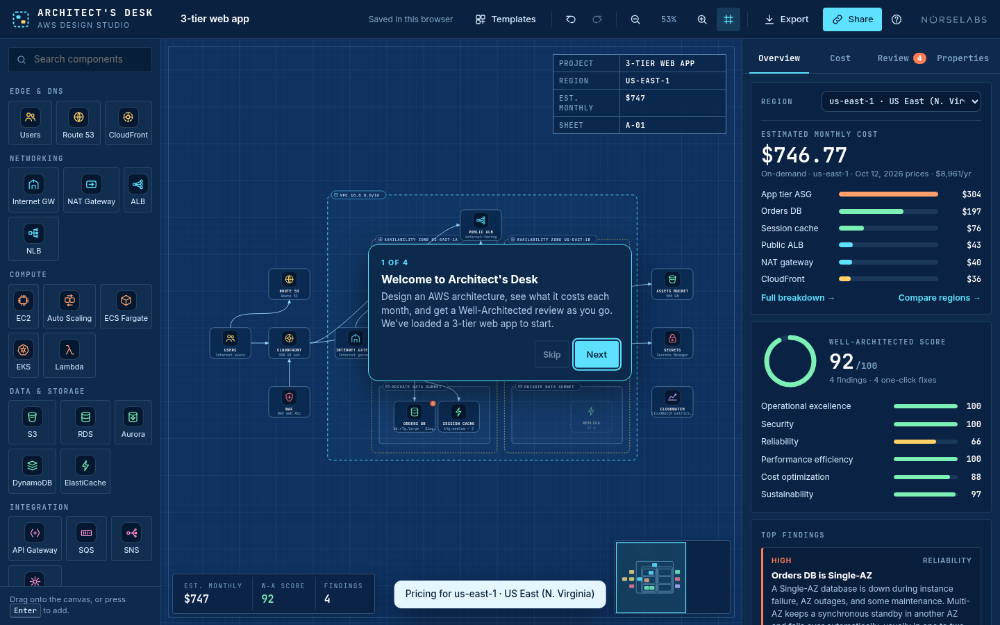
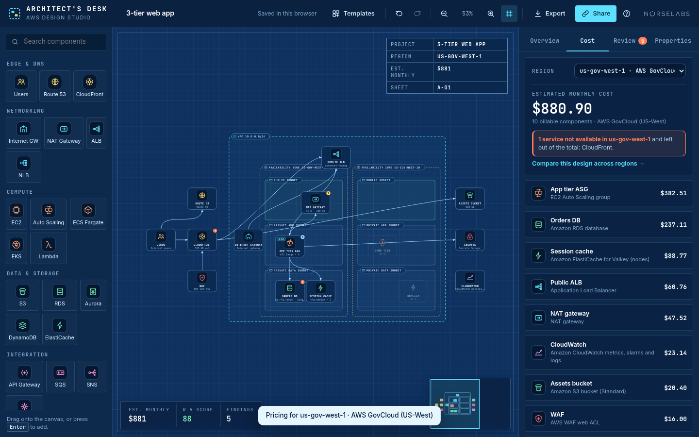
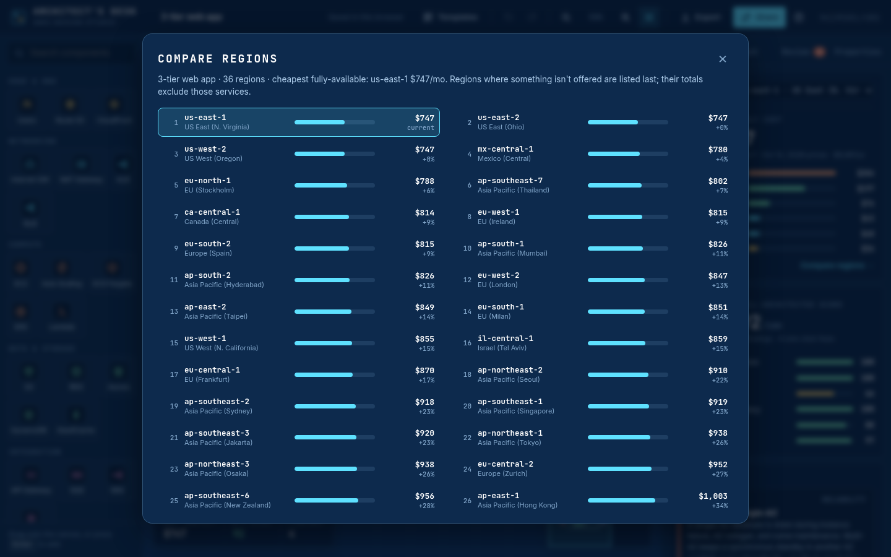

# Architect's Desk

**Design AWS architectures on a blueprint canvas, see what they cost each month in any of 36 regions, GovCloud included, and get a Well-Architected review as you go.**

Architect's Desk is a browser-based AWS architecture canvas. You drag services onto a blueprint, connect them and set their sizes. It estimates the monthly cost from published AWS prices and scores the design on the six AWS Well-Architected pillars, with one-click fixes. It runs at **[norselabs.net/architect](https://norselabs.net/architect/)** and as an offline macOS app.



---

## Contents
- [Features](#features)
- [Well-Architected review](#well-architected-review)
- [Component catalog](#component-catalog)
- [Pricing](#pricing)
- [Getting started](#getting-started)
- [Using it](#using-it)
- [Keyboard shortcuts](#keyboard-shortcuts)
- [Building from source](#building-from-source)
- [Project structure](#project-structure)
- [Privacy](#privacy)
- [Related: Perimeter Zero](#related-perimeter-zero)
- [Disclaimer](#disclaimer)
- [License](#license)
- [Author](#author)

## Features
- **Blueprint canvas.** Drag and drop, connect services with arrows, snap to grid, pan and zoom, minimap, and VPC / AZ / subnet group boxes. Nodes placed inside an AZ take that AZ.
- **28 component types** across edge, networking, compute, data, integration, security and operations (see [Component catalog](#component-catalog)).
- **Well-Architected review.** Scores the six pillars 0–100 with findings by severity, one-click fixes, **Apply all** and undo.
- **Region-aware cost.** Estimates use AWS Price List snapshots for 36 regions, including both GovCloud regions. Each cost line shows its calculation. Services or instance types with no price in a region are marked **Not available** instead of being estimated.
- **Compare regions.** Prices the current design in every region, sorted cheapest first.
- **Templates.** 3-tier web app, serverless API, static site, containerized microservices, data pipeline, and a blank canvas.
- **Exports.** PNG, SVG, JSON and starter Terraform.
- **Save, share, autosave.** JSON files, links that contain the diagram, and automatic local saving in the browser.
- **Phones.** Opens in a read-only review mode at narrow widths.

## Well-Architected review
The **Review** tab scores the design on the six pillars of the AWS Well-Architected Framework:

**Operational excellence · Security · Reliability · Performance efficiency · Cost optimization · Sustainability**

Each pillar starts at 100 and loses points for every finding in it: Critical 35, High 22, Medium 12, Low 6, Note 0. Some findings also take half their weight from a second pillar. The overall score is the mean of the six pillars. Most findings include a one-click fix.

| Pillar | Rule |
|---|---|
| Reliability | Compute runs in a single Availability Zone |
| Reliability | No load balancer in front of compute |
| Reliability | EC2 is a lone instance with no load balancer |
| Reliability | One NAT gateway serves several AZs |
| Reliability | RDS is Single-AZ |
| Reliability | RDS has automated backups turned off |
| Reliability | Aurora has only a writer instance |
| Reliability | DynamoDB has no point-in-time recovery |
| Reliability | S3 versioning is off |
| Reliability | ElastiCache has no automatic failover |
| Reliability | SQS has no dead-letter queue |
| Security | Database is reachable from the internet |
| Security | Database storage is not encrypted |
| Security | Instances allow SSH from anywhere |
| Security | EBS volumes are unencrypted |
| Security | EC2 has a public IP behind a load balancer |
| Security | S3 Block Public Access is off |
| Security | Public entry point without AWS WAF |
| Security | Database credentials have no secrets store |
| Operational excellence | No monitoring or alarms |
| Performance efficiency | No CDN in front of the site |
| Performance efficiency | Consider a cache for hot reads (note) |
| Cost optimization | Graviton (Arm) instances could cost less (uses the selected region's prices) |
| Cost optimization | S3/DynamoDB traffic may go through the NAT gateway |
| Cost optimization | Fixed fleet sized for peak |
| Sustainability | Mostly managed and serverless (positive note) |
| Any | A service or instance type isn't available (has no price) in the selected region. The fix switches to an available type where there is one |

## Component catalog

| Category | Components |
|---|---|
| Edge & DNS | Users, Route 53, CloudFront |
| Networking | Internet Gateway, NAT Gateway, ALB, NLB |
| Compute | EC2, Auto Scaling, ECS Fargate, EKS, Lambda |
| Data & storage | S3, RDS, Aurora, DynamoDB, ElastiCache |
| Integration | API Gateway, SQS, SNS, EventBridge |
| Security | WAF, KMS, Secrets Manager |
| Operations | CloudWatch |
| Groups | VPC, AZ, Subnet (public / private) |

Each component has editable properties: instance types and counts, engines and classes, Multi-AZ, storage, request and traffic volumes, encryption, public access and similar settings. Cost and review update as you edit.

## Pricing
- **Source:** AWS Price List Bulk API regional CSV offer files (`pricing.us-east-1.amazonaws.com/offers/v1.0/aws/<service>/current/<region>/index.csv`), on-demand terms. The snapshots ship with the app as JSON in `src/data/regions/`, fetched **2026-10-12**. The app does not fetch live prices.
- **Regions:** 36, including **us-gov-west-1** and **us-gov-east-1**.
- **Assumptions:** 730 hours per month and USD. Usage values such as GB transferred, requests and storage are properties on each component, and every cost line shows its calculation.
- **Global services:**
  - **CloudFront** is priced at the US/Canada/Europe first-10 TB rate in every commercial region. It isn't offered in GovCloud.
  - **Route 53** uses its global hosted-zone and query rates. GovCloud uses its own standard-query rate.
- **Not available:** when a service or instance class has no on-demand price in the selected region, it's marked **Not available**, it adds **$0** (there's no fallback to another region's price), and the review raises a region finding with a switch-type fix where possible. For example, CloudFront in GovCloud. In Compare regions, regions with gaps are listed last and their totals leave those items out.
- **Shared with Perimeter Zero:** the extractor in `pricing/` also produces the base prices (EC2, RDS, ALB and so on) used by [Perimeter Zero](#related-perimeter-zero), the Zero Trust edition.





## Getting started

### Web
Open **https://norselabs.net/architect/**. You don't need an account or an install. Editing works best on a desktop browser. On phones it opens in review mode.

### macOS app
The offline app is built with Electron and ships as two zips, one per architecture:

| File | Mac |
|---|---|
| `Architects-Desk-1.0.0-mac-arm64.zip` | Apple Silicon |
| `Architects-Desk-1.0.0-mac-x64.zip` | Intel |

It needs macOS 13 or later. Check the download with `shasum -a 256 -c SHA256SUMS.txt`.

1. Unzip by double-clicking, or run `ditto -x -k Architects-Desk-1.0.0-mac-arm64.zip .`. Then drag **Architect's Desk.app** to /Applications.
2. The app is **not notarized**, so macOS blocks it the first time:
   - **macOS 15 and later:** double-click the app and choose **Done**. Then open **System Settings ▸ Privacy & Security**, click **Open Anyway** next to Architect's Desk, authenticate, and click **Open**.
   - **macOS 13–14:** right-click (Control-click) the app ▸ **Open** ▸ **Open**.
3. If macOS says the app **"is damaged and can't be opened"**:
   ```sh
   xattr -cr "/Applications/Architect's Desk.app"
   codesign --force --deep -s - "/Applications/Architect's Desk.app"
   open "/Applications/Architect's Desk.app"
   ```
   The build already ships with an ad-hoc signature, so the `codesign` line is only a fallback.

## Using it
1. **Templates.** Press **T** or click **Templates**. The cards show each template's estimated monthly cost.
2. **Add and connect.** Drag a component from the palette onto the canvas, or focus it and press **Enter**. Drag from a node's port onto another node to connect them. Drop services inside VPC, AZ and subnet boxes to place them.
3. **Properties.** Select a node to edit it in the **Properties** tab. Cost and review update as you type.
4. **Review.** The **Review** tab lists findings by severity with pillar scores.
   - Click a fix button to apply it, or **Show** to highlight the affected nodes.
   - **Apply all** fixes everything in one step, and **Ctrl/⌘ Z** undoes it.
   - Some fixes also draw a ghost of what they added, for example a standby database.
5. **Region.** Pick a region in the Overview or Cost panel. AZ labels follow the region. **Compare regions** prices the design everywhere, and clicking a region switches to it.
6. **Export.** Use the **Export** menu:
   - **PNG / SVG:** the diagram.
   - **JSON:** the full diagram, which you can reopen later.
   - **Terraform:** a starter `.tf` for AWS provider v5.
     - It generates the VPC, subnets, internet and NAT gateways, route tables, S3/DynamoDB gateway endpoints, security groups, ALBs with listeners and target groups, EC2 instances, Auto Scaling groups with launch templates, RDS instances, Aurora clusters, DynamoDB tables, S3 buckets, Lambda functions with an IAM role, SQS, SNS, EventBridge, KMS keys and Secrets Manager secrets.
     - It lists CloudFront, WAF, Route 53, API Gateway, ECS, EKS, ElastiCache, CloudWatch and NLB as **TODO** comments rather than guessing their many design-specific settings.
     - It's a validated skeleton, not production-ready.
7. **Save and share.**
   - **Save JSON / Open JSON** work with local files.
   - **Share** puts the compressed diagram in the link (`#d=…`) and copies it.
   - Work autosaves to the browser's localStorage.

## Keyboard shortcuts
These come from the app's key handler. **Ctrl** also means **⌘** on macOS.

| Keys | Action |
|---|---|
| Ctrl Z / Ctrl Shift Z (or Ctrl Y) | Undo / redo |
| Delete or Backspace | Delete selection |
| Ctrl D | Duplicate |
| Ctrl A | Select all |
| Arrow keys (Shift for bigger steps) | Nudge selection |
| Ctrl S / Ctrl O | Save / open JSON |
| Ctrl E | Export PNG |
| + / − | Zoom in / out |
| F / 0 | Fit to screen / reset zoom |
| G | Snap to grid on/off |
| T | Templates |
| ? | Help |
| Esc | Close dialog, clear selection |
| Enter (on a palette item) | Add it to the canvas |
| Drag empty space / Shift-drag | Pan / box-select |

The macOS app adds menu shortcuts:

| Menu | Item | Shortcut |
|---|---|---|
| File | New from Template | ⌘N |
| File | Open JSON | ⌘O |
| File | Save JSON | ⌘S |
| File | Export PNG | ⇧⌘P |
| File | Export SVG | ⇧⌘S |
| File | Export Terraform | ⇧⌘T |
| Edit | Undo / Redo | ⌘Z / ⇧⌘Z |
| View | Zoom In / Zoom Out / Fit to Window | ⌘= / ⌘− / ⌘0 |
| Help | How Architect's Desk Works | F1 |

## Building from source
**Web app.** There's no build step: plain HTML, CSS and JavaScript with no dependencies. Serve `src/` with any static server:
```sh
python3 -m http.server 8601 --directory src
# open http://localhost:8601/
```
Prices are fetched from `src/data/regions/*.json`, so open the app over HTTP rather than `file://`. `src/` is the Blueprint design: `css/base.css` holds the layout and components, and `css/theme.css` the Blueprint colors.

**Price data** (`pricing/`, Python 3, standard library only).
- `python3 pricing/extract_region.py <region>` streams that region's AWS Price List CSV offer files from the public endpoint and writes the extracted price keys to `pricing/regions/<region>.json`. Some offer files are hundreds of MB, so they're streamed, not stored. That output isn't committed.
- `pricing/fetch_global_offers.sh` downloads the global CloudFront and Route 53 offers (git-ignored).
- `python3 pricing/make_regions.py` rebuilds `src/data/regions/*.json` and `index.json`.
- Re-fetching all regions:
  ```sh
  for r in $(cat pricing/region-list.txt); do python3 pricing/extract_region.py "$r"; done
  ./pricing/fetch_global_offers.sh
  python3 pricing/make_regions.py
  ```
- The CloudFront data-out and request rates (US/Canada/Europe first tier) and the Route 53 hosted-zone and commercial query rates are constants in `make_regions.py`. The global offers supply the publication dates and the GovCloud query rates.
- These region files are also the base that Perimeter Zero's pricing scripts merge their Zero Trust service prices into.

**macOS app** (`mac/`).
```sh
cd mac
npm ci                    # Electron + @electron/packager (pinned in package.json)
./fetch-rcodesign.sh      # once: downloads rcodesign 0.29.0 (checksum verified) into mac/tools/ (git-ignored)
./build.sh                # → mac/out/ (darwin arm64 + x64, linux x64) and mac/dist/*.zip + SHA256SUMS.txt
npm start                 # run the app locally from source (Electron)
```
- `mac/app/` holds the Electron main and preload scripts plus `web/`. `web/` is a copy of `src/` with desktop changes:
  - an app-origin CSP meta tag
  - `js/desktop.js`, which maps the native menu commands onto the app's buttons
  - share links that point at https://norselabs.net/architect/
  - the wordmark linking out to norselabs.net
- After changing `src/`, copy it into `mac/app/web/` again and keep those changes.
- `build.sh` packages with `@electron/packager` and ad-hoc signs the macOS bundles with `rcodesign`. Set `RCODESIGN=/path/to/rcodesign` to use a different binary. On macOS you can sign with `codesign --force --deep -s -` instead.
- It zips the apps with `zip -ry` (keeps framework symlinks).
- It runs on Linux. The macOS builds are unsigned and not notarized.

**Tests** (`tests/`, Playwright, using a local Chrome or Chromium).
```sh
cd tests && npm ci
npm run serve &                         # serves ../src on http://localhost:8601/
npm run test:web                        # editor features at 1440 and 390 px, 0 console errors required
npm run test:region                     # region pricing, GovCloud, not-available handling, compare, share/autosave
npm run test:electron                   # Electron Linux build (run mac/build.sh first; needs xvfb-run)
npm run tf:generate                     # writes tests/output/tf/<template>/main.tf for every template
```
- `tests/web.test.js` covers onboarding, templates, drag and drop, connecting, moving, properties, undo/redo, review fixes and Apply all, exports, Open JSON, delete, share, autosave, zoom, help and mobile review mode.
- `tests/region.test.js` covers region pricing.
- `tests/electron.test.js` covers offline loading, the security settings, every native menu item, GovCloud repricing and window-state persistence.
- To validate the generated Terraform, run `terraform init -backend=false && terraform validate` in each output folder.
- Settings come from environment variables:
  - `AD_BASE`: the URL under test
  - `CHROME_PATH`: the Chrome or Chromium binary
  - `AD_ELECTRON`: the Electron executable
  - `AD_OUT`: where screenshots and exports go
- Output goes to `tests/output/` (git-ignored).

## Project structure
```
src/                    the web app (Blueprint design)
  index.html
  css/                  base.css (layout, components), theme.css (Blueprint theme)
  js/
    catalog.js          component types, properties, icons
    cost.js             cost lines from regional price data
    analysis.js         Well-Architected review, one-click fixes, pillar scores
    templates.js        templates
    terraform.js        starter Terraform generator
    app.js              canvas, panels, undo/redo, regions, save/share/export
  data/regions/         36 regional price snapshots + index.json
  fonts/                Inter and JetBrains Mono (OFL)
pricing/                extract_region.py, make_regions.py, fetch_global_offers.sh, region-list.txt
mac/                    Electron app: app/ (main.js, preload.js, web/), build/ (icon), build.sh, fetch-rcodesign.sh, package.json
tests/                  Playwright tests (web, region, Electron) and the Terraform generator
docs/images/            README screenshots
```

## Privacy
- **No accounts, cookies, analytics or telemetry.** The only network requests the web app makes are for its own files on the same origin, including the regional price JSON. The source contains no third-party scripts or tracking code.
- **Your diagrams stay on your device.** They're stored in your browser's localStorage. Share links carry the diagram in the URL fragment (`#d=…`), which browsers don't send to the server.
- **The macOS app is fully offline.** All assets, fonts and price data are bundled and served from an internal `app://` origin. The app blocks every outgoing http(s) and WebSocket request. External links open in your default browser.
- **macOS app security settings:** context isolation on, Node integration off, sandboxed renderer, Content Security Policy, and navigation and new windows locked down.

## Related: Perimeter Zero
[Perimeter Zero](https://norselabs.net/zerotrust/) is the Zero Trust edition of Architect's Desk. It adds identity, Zero Trust access, detection and governance components, and a review aligned with the CISA Zero Trust Maturity Model and NIST SP 800-207. Its prices build on the regional snapshots produced here.

## Disclaimer
Architect's Desk produces an automated review of a **diagram**, informed by the AWS Well-Architected Framework. It is not an AWS Well-Architected Review, an AWS Well-Architected Tool assessment, or a security or compliance assessment of a deployed system. Cost figures are estimates from published on-demand list prices and the usage assumptions shown. They exclude taxes, discounts, Reserved Instances, Savings Plans and most free tiers (the few that are applied, such as the DynamoDB 25 GB of free storage, are noted on the cost line). Generated Terraform is a starting point and must be reviewed before use.

Architect's Desk is an independent project. It is not affiliated with, endorsed by, or sponsored by Amazon Web Services. AWS, Amazon Web Services, AWS Well-Architected and the names of AWS services are trademarks of Amazon.com, Inc. or its affiliates. Terraform is a trademark of HashiCorp. Other names are trademarks of their respective owners.

## License
All rights reserved. No license granted yet.

## Author
**Arnar DeMarco** · Norselabs · [norselabs.net](https://norselabs.net)
